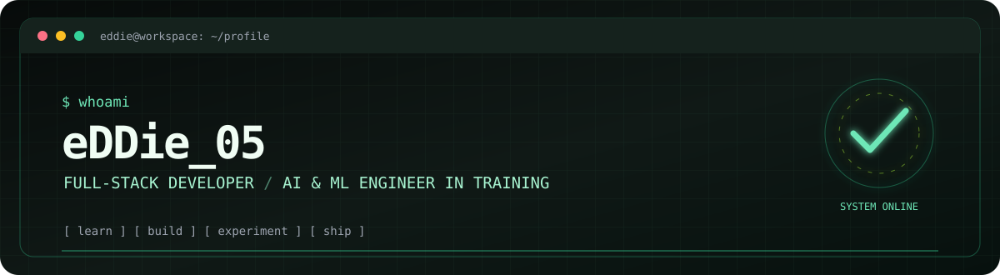
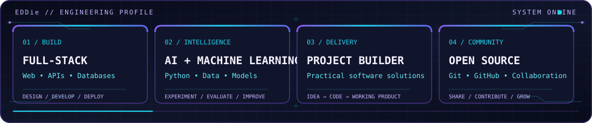
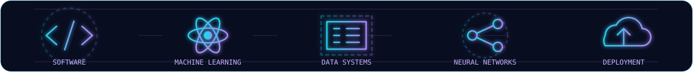
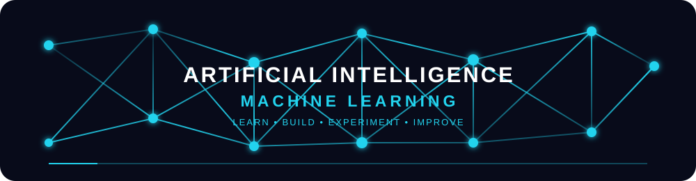

<!-- Animated profile header -->

  

  

  
  
  

## ✨ Profile Highlights & Achievements

  

  
  
  
  

  
  
  

These are profile highlights and live public GitHub metrics, not claimed certifications or manually awarded GitHub achievements.

  

  

## 👋 About me

  

I'm **eDDie**, a full-stack developer and security-systems professional from **Tanzania**, focused on building practical software and deploying reliable physical-security technology. I enjoy working across the frontend and backend, learning new tools, and turning ideas into working projects.

- 💻 **Focus:** Full-stack development, Artificial Intelligence, Machine Learning, cybersecurity, and physical security systems
- 🛡️ **Security systems:** CCTV installation, IP surveillance, access control, and Dahua security technologies
- 🎓 **Certification:** Dahua-certified professional with DSS / VMS professional certification
- 🔭 **Building:** Web applications, database-backed systems, and useful developer tools
- 🧩 **Technical focus:** Machine learning, deep learning, data science, LLMs, AI agents, and modern full-stack engineering
- 🧠 **Interested in:** Clean code, databases, UI/UX, automation, and open source
- 🤝 **Open to:** Learning, collaboration, and beginner-friendly open-source contributions
- 🌍 **Based in:** Tanzania

## 🛡️ Physical Security & Surveillance Systems

  

I also work with **professional physical security and electronic security systems**, combining hands-on installation with software, networking, and centralized security management.

### 📹 CCTV & Video Surveillance
- CCTV system installation, configuration, testing, and troubleshooting
- IP camera deployment and network-based surveillance
- Camera positioning, connectivity, recording, and monitoring
- NVR/DVR setup and configuration
- Surveillance system maintenance and fault diagnosis
- Basic networking for IP surveillance environments

### 🚪 Access Control & Entry Management
- Access-control system installation and configuration
- Door/access-point device setup and management
- User, credential, and access-permission configuration
- Integration of access-control devices with centralized security platforms
- Troubleshooting connectivity and device-management issues

### 🔐 Dahua Technology
I have hands-on experience working with **Dahua Technology security solutions**, including CCTV/video surveillance, access control, and centralized security management.

  
  
  
  

### 🎓 Dahua DSS Professional Certification

**Dahua-certified professional in DSS / Video Management System (VMS) technology.**

My DSS professional capability covers centralized security management and practical operation of the platform, including areas such as:

- DSS deployment, installation, licensing, and upgrades
- Device, user, and storage configuration
- Video monitoring and event management
- Access control and video-intercom configuration
- Visitor and attendance management
- Vehicle entrance/exit management
- Maintenance and centralized security operations
- Multi-server / distributed DSS concepts
- Security-system integration and centralized management

Dahua describes DSS Professional as a unified security-management platform integrating video surveillance, access management, vehicle entrance/exit, intelligent analysis, maintenance, attendance, and other security functions. urlDahua DSS Professionalhttps://www.dahuasecurity.com/products/software/on-premise-software/software-products/dss-professional

> **Certification:** Dahua Technology — DSS / VMS Professional certification  
> **Credential:** Dahua Certified Professional Engineer / Professional certification as applicable to the completed Dahua certification program.

  

Certification wording is kept aligned with Dahua's official certification terminology; the exact certificate title and credential ID should always be taken from the certificate itself.

## 🗺️ Engineering Roadmaps

  

My development roadmap covers **Full-Stack Engineering** and **Machine Learning**, with a focus on strengthening architecture, implementation, and practical problem-solving.

  

## 🧰 Technology stack & engineering tools

  

  

### Programming languages & web technologies

**Core technologies**

  
  
  
  
  
  
  
  

**Additional languages to explore**

  
  
  
  
  
  
  
  
  
  
  
  
  
  
  
  
  

  

The first row reflects technologies currently used or studied. The additional badges and icon grid showcase languages to explore; they do not imply professional experience in every language.

### Frameworks, databases & tools

  
  
  
  
  
  
  
  
  
  
  

Tech badges represent tools used in projects or currently being explored; experience varies by technology.

## 🧠 Artificial Intelligence & Machine Learning

  

  

I work at the intersection of **software engineering, data, and Artificial Intelligence**. My technical focus spans Python development, machine learning workflows, deep learning concepts, and building practical AI-powered applications.

  

### Foundations & data science

  
  
  
  
  
  
  

- **Mathematics:** linear algebra, vectors and matrices, tensors, eigenvalues, SVD, calculus, gradients, Jacobians, Hessians, and probability.
- **Data science:** data collection, data formats, data cleaning, exploratory analysis, visualization, preprocessing, and feature engineering.

### Machine learning

  
  
  
  

- **Algorithms & methods:** regression, classification, clustering, regularization (Ridge, Lasso, Elastic Net), model selection, and hyperparameter tuning.
- **Evaluation:** train/test splits, cross-validation, validation strategies, metrics, and model diagnostics.
- **Concepts:** supervised, unsupervised, and reinforcement learning; feature engineering; ensemble learning; and explainable AI (SHAP/LIME concepts).

### Deep learning, NLP & modern AI

  
  
  
  
  
  

- **Deep learning concepts:** neural networks, activation functions, backpropagation, optimizers, RNNs, LSTMs/GRUs, attention, and Transformers.
- **NLP concepts:** text preprocessing, tokenization, bag-of-words, TF-IDF, embeddings, text classification, sentiment analysis, and named entity recognition.
- **AI engineering concepts:** LLM applications, tool use, agent workflows, retrieval-augmented generation (RAG), and responsible AI design.

### Engineering workflow & tools

  
  
  
  
  

- **Workflow:** reproducible experiments, data/model pipelines, API concepts, deployment fundamentals, and model monitoring concepts.

These are learning areas and developing skills, not a claim of professional mastery or production experience in every listed tool. I aim to demonstrate progress through working projects, documented experiments, and measurable results.

---

## 🚀 Featured software projects

  

| Project | Description | Technologies |
| --- | --- | --- |
| [HRAS](https://github.com/eDDie-05/HRAS) | Front-end prototype for hospital registration and appointment workflows. | HTML, CSS |
| [Student Management System](https://github.com/eDDie-05/Student-Management-System-stms-) | Menu-driven application for managing student records. | C |
| [Library Management System](https://github.com/eDDie-05/Libms) | Console application for books and issue/return status. | C |
| [Text-to-Speech Converter](https://github.com/eDDie-05/Converter) | Python tool that converts text into spoken audio. | Python, gTTS |
| [Movie Mania](https://github.com/eDDie-05/movie-database-app) | Movie and TV discovery interface. | React, Vite |
| [Stock Market Tracker](https://github.com/eDDie-05/Stock-Market-Tracker) | Desktop stock lookup and information tool. | Python, Tkinter |
| [Desktop Chatbot](https://github.com/eDDie-05/AI-Chatbot) | Rule-based desktop chatbot. | Python, Tkinter |

**More builds:** [Browse all my repositories](https://github.com/eDDie-05?tab=repositories).

## ⚡ Live GitHub Profile

  

  
  
  

  

GitHub-hosted and public-profile metrics above are generated from the account and update as GitHub activity changes. Skills and certifications are intentionally kept as human-authored claims rather than inferred automatically from repository activity.

## 📊 GitHub Analytics & Activity

  

  <strong>📈 PROFILE OVERVIEW</strong>

  
  
  

<table align="center">
  <tr>
    <td width="50%" align="center">
      
    </td>
    <td width="50%" align="center">
      
    </td>
  </tr>
</table>

  <strong>🔥 CONTRIBUTION STREAK</strong>

  

  

  

  

  

  Contribution graph: automatically reflects public GitHub contribution activity. Coding-time card: displays real editor activity only after you create a WakaTime account, install its editor extension, record coding activity, and use your exact WakaTime username in the image URL. Never publish your WakaTime API key in this README.

## 🌐 Connect with me

  

  
  
  

  <i>“Build. Learn. Improve. Repeat.”</i>

  

